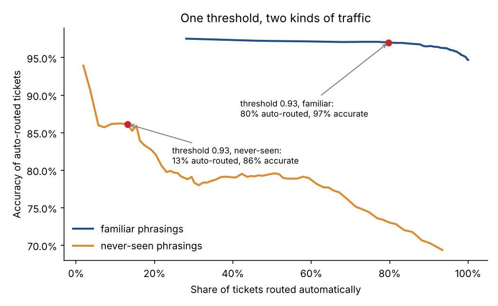
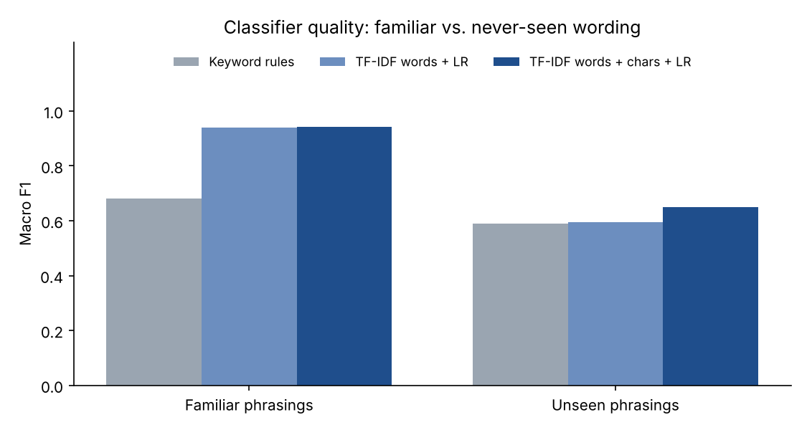
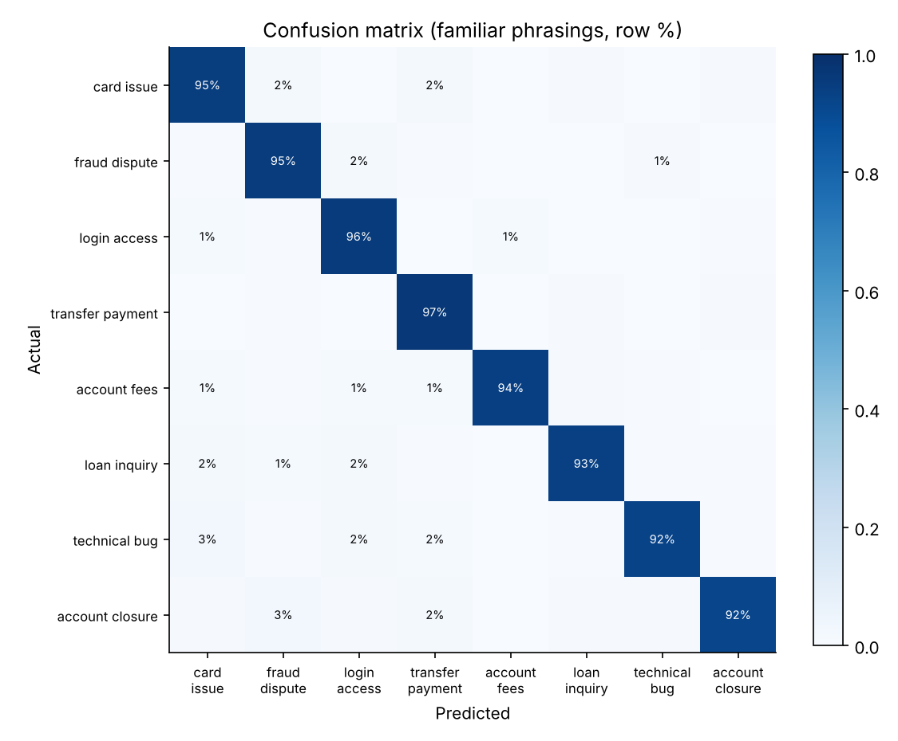

# Support Ticket Classification: Automate the Easy 80%, Know What You Don't Know

Routing incoming customer support tickets for a digital bank to the right queue automatically. The model auto-routes confident predictions and sends the rest to people, and the project tests what happens when customers describe problems in ways the model has never seen.

  

> **Data note:** all 12,000 tickets are synthetic, produced by [`data/generate_data.py`](data/generate_data.py) from about 18 phrasing patterns per category with randomized details (merchants, amounts, devices, dates). Realistic mess is added on top: inconsistent casing, typos, greetings and sign-offs, extra context, 12% of tickets mentioning a second topic, and 3% mislabeled tickets (agents don't always agree either).

---

## The business problem

A support team triages every ticket by hand before anyone starts solving it. Misrouted tickets bounce between queues, and urgent ones (fraud, account lockouts) wait in line behind routine questions. Auto-routing saves triage time, **but only if the routed tickets are right**.

**The design question:** how many tickets can be routed automatically while keeping routing accuracy at 97%? And what protects quality when customers start describing problems in new ways (a new product launch, a new scam)?

## Results at a glance

| | |
|---|---|
| **Model** | TF-IDF (word 1–2-grams + character 3–5-grams) → logistic regression |
| **Accuracy, familiar phrasings** | **94.7%** (macro F1 0.94); 97.5% against the intended category once the 3% label noise is removed |
| **Auto-routing at confidence ≥ 0.93** | **80% of tickets routed automatically at 97% accuracy**; the other 20% go to a person |
| **Urgent tickets (fraud + login) correctly flagged** | 96.7% |
| **On never-seen phrasings** | Accuracy drops to 67%, **but the same threshold automatically cuts automation to 13%**, sending most of these tickets to people |

The last row is the main finding. A standard random train/test split reports about 95% and stops there. This project also holds out entire *phrasings* and shows what that number hides, and how confidence-based routing limits the damage.



## Approach

### 1. Two test sets, not one
- **Familiar phrasings:** a random 20% of tickets. New tickets with different details, written in ways the model has seen before. This mirrors most day-to-day traffic.
- **Never-seen phrasings:** 3 of the roughly 18 phrasing patterns in each category are **held out of training entirely**, including when they appear as the secondary topic in another ticket ([leakage test](tests/test_tickets.py)). This mirrors new products, new issues and new ways of describing them.

### 2. Models
| Model | Familiar phrasings (acc / macro F1) | Never-seen phrasings (acc / macro F1) |
|---|---|---|
| Keyword rules (typical help-desk starting point) | 66.4% / 0.68 | 60.8% / 0.59 |
| TF-IDF words → logistic regression | 94.4% / 0.94 | 61.8% / 0.60 |
| **TF-IDF words + characters → logistic regression** | **94.7% / 0.94** | **66.8% / 0.65** |

Character n-grams help most on new phrasings and typos: "declineed", "passcode" and "log-in" still share fragments with words the model knows.



### 3. Confidence-based routing
The model outputs a probability for each queue. Tickets above a confidence threshold are routed automatically, and the rest go to a human triage queue. The threshold is chosen on familiar traffic as **the lowest one that keeps auto-routed accuracy at 97%** (0.93), which routes 80% of tickets automatically.

That **same threshold** applied to never-seen phrasings:
- Automation drops from 80% to **13%**, so the model correctly lowers its confidence on unfamiliar text.
- The tickets it still routes are 86% accurate, worse than the 97% target but far better than the 67% it would get by routing everything.

**In production, a sudden drop in the automation rate works as a drift alarm.** It signals that customers are describing something new and the model needs fresh training examples.

### 4. Where it goes wrong
The confusion matrix on familiar traffic is clean ([per-class report](reports/tables/per_class_seen.csv)). The most confident errors on new phrasings are mostly **two-topic tickets**, where the model latches onto the second request ([examples](reports/tables/top_errors_unseen.csv)). For example, "my passcode never shows up. Also, requesting a replacement card" gets routed to cards instead of login. A production version would split multi-intent tickets or route them to both queues.



## LLM comparison (included, not yet run)

Large language models are the obvious candidate for phrasings a TF-IDF model has never seen, since they understand meaning rather than matching vocabulary. The repo includes a ready-to-run zero-shot harness:

- [`prompts/classify_ticket.md`](prompts/classify_ticket.md): queue definitions and JSON output format
- [`src/ticketclf/llm.py`](src/ticketclf/llm.py): calls the Anthropic Messages API, parses defensively, caches every response, and scores the **same never-seen-phrasings test set**

```bash
export ANTHROPIC_API_KEY=...
make llm-eval        # 400 tickets; writes reports/llm_metrics.json
```

**These results are not in this README yet.** Running the harness needs an API key. When it runs, it reports accuracy alongside tokens per ticket, so the decision can include cost. A sensible production design is a **hybrid**: the fast, nearly free TF-IDF model handles the confident 80%, and the low-confidence tickets go to the LLM before falling back to a person.

## Repository structure

```
├── data/generate_data.py          # synthetic ticket generator (templates + realistic noise)
├── prompts/classify_ticket.md     # LLM routing prompt
├── src/ticketclf/
│   ├── models.py                  # keyword rules, TF-IDF + logistic regression models
│   ├── routing.py                 # confidence threshold vs. automation/accuracy
│   ├── pipeline.py                # splits, training, evaluation, figures
│   └── llm.py                     # optional zero-shot LLM comparison (not run here)
├── reports/                       # metrics.json, figures/, tables/
├── tests/                         # leakage, routing and parsing tests
└── Makefile
```

## Run it yourself

```bash
git clone https://github.com/chatnic/support-ticket-classification.git
cd support-ticket-classification
python -m venv .venv && source .venv/bin/activate
make setup
make all      # generate tickets -> train -> evaluate -> tests (~10 seconds)
```

## What I'd do next in a real engagement

- **Run the LLM comparison** and evaluate the hybrid routing design on cost per 1,000 tickets.
- **Detect multi-intent tickets** and split them, the largest single source of confident errors.
- **Use active learning:** label the low-confidence tickets first, since they carry the most new information.
- **Monitor** automation rate and per-queue accuracy weekly, and retrain when automation drops.

## License

MIT. See [LICENSE](LICENSE).
